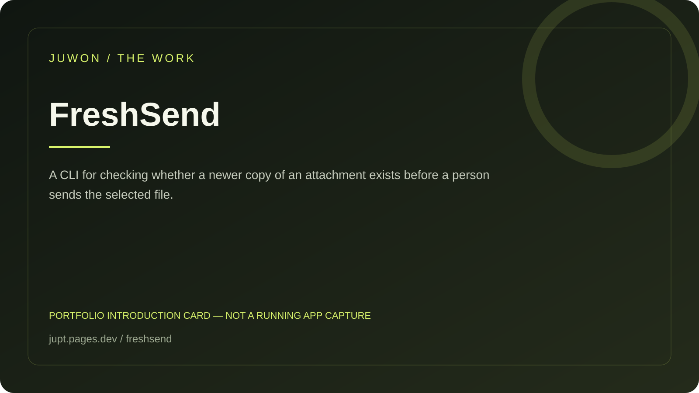

<!-- JUWON-PORTFOLIO-INTRO:START -->
# FreshSend



*Portfolio introduction card, not a screenshot of a running application.*

*포트폴리오 소개 카드입니다. 실행 화면 캡처가 아닙니다.*

## English

A CLI for checking whether a newer copy of an attachment exists before a person sends the selected file.

[View JUWON's portfolio](https://jupt.pages.dev/) · [Browse the project collection](https://jupt.pages.dev/projects)

**Scope:** This README presents the repository's documented intent and recorded visual evidence. It does not certify that every feature is complete, deployed, or currently working. Follow the original setup, safety, and license documentation below.

## 한국어

첨부하려는 파일보다 최신 사본이 있는지 전송 전에 확인하는 CLI.

[JUWON 포트폴리오 보기](https://jupt.pages.dev/) · [전체 프로젝트 보기](https://jupt.pages.dev/projects)

**확인 범위:** 저장소의 문서상 목적과 기록된 화면 근거를 소개합니다. 모든 기능의 완성·배포·현재 정상 작동을 보증하지 않습니다. 설치법·안전 주의사항·라이선스는 아래 기존 문서를 확인하세요.
<!-- JUWON-PORTFOLIO-INTRO:END -->

---

## Original documentation / 기존 문서

# FreshSend 🟢

## Stop sending yesterday’s file.

Before you attach a report, log, config, or prompt to an AI chat, email, or issue, run one local check:

```text
freshsend check ./outgoing/report.txt --against ./workspace
```

FreshSend finds a newer same-name file and says **STALE** before an old attachment leaves your machine. If no newer copy exists, it says **FRESH**. It is local-first, read-only, and provider-neutral.

## Why this exists

AI tools and upload forms can confirm that *a* file was attached without telling you whether it was the latest local copy. FreshSend puts a visible decision at the hand-off boundary: the exact file you selected, the directory you allowed it to inspect, and the newer path that needs your attention.

## Quick start

```powershell
python -m pip install -e .

# Make the newer demo copy newer on filesystems that restore both files together.
(Get-Item .\examples\demo-workspace\workspace\report.txt).LastWriteTime = (Get-Date).AddMinutes(1)

# Human-readable pre-send check
freshsend check .\examples\demo-workspace\outgoing\report.txt `
  --against .\examples\demo-workspace

# CI/script-friendly output; exit code is 1 when stale
freshsend check .\examples\demo-workspace\outgoing\report.txt `
  --against .\examples\demo-workspace --format json
```

The included example becomes `STALE` after the one-line timestamp update because `workspace/report.txt` is newer than the outgoing copy. Update or remove that file to see `FRESH`.

## Exit codes

| Code | Meaning |
| ---: | --- |
| `0` | No newer same-name file was found. |
| `1` | A newer same-name file was found; review before sending. |
| `2` | The explicit path or comparison directory was invalid or unreadable. |

## Safety promise 🔒

- No network calls, model calls, uploads, subprocesses, or background watchers.
- No file changes: FreshSend only reads metadata and calculates SHA-256 for the report.
- You provide both paths explicitly; there is no implicit home-directory scan.
- Symlink candidates and symlinked matches are rejected or skipped so the check does not follow unexpected paths.
- A `STALE` result is a warning, never an automatic replacement or send.

## What it checks

FreshSend recursively looks for the same filename under `--against`, excluding the candidate itself. It compares modification time and includes file size, UTC modification time, and SHA-256 in JSON output. The first release intentionally does not guess that `report-final-2.txt` is related to `report.txt`; that is a future, opt-in matching rule.

## Development

```powershell
python -m pytest
ruff check .
mypy src
python -m build
pip-audit --path dist
```

See [CONTRIBUTING.md](CONTRIBUTING.md) and [SECURITY.md](SECURITY.md). The project is MIT-licensed.

## Founder hypothesis

The first users are people who attach changing files to AI chats and issue trackers. The 7-day experiment is to give ten developers this one command and count how many times it catches an older same-name file before upload. A future paid path could add team policies or signed receipts, but the core check remains local and open.
